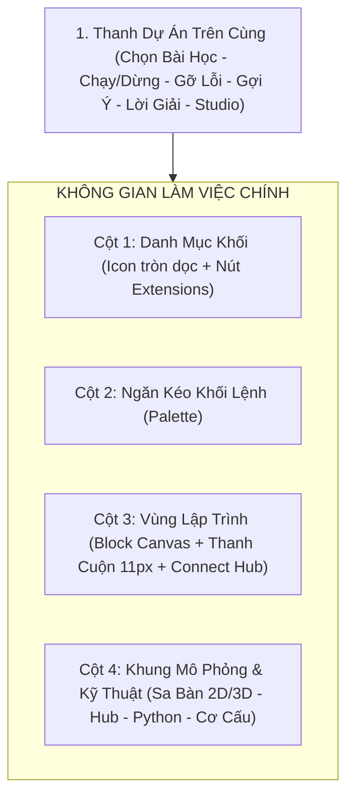
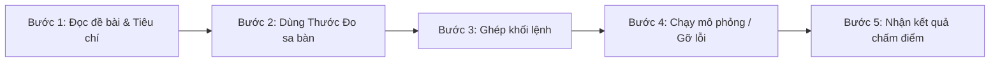
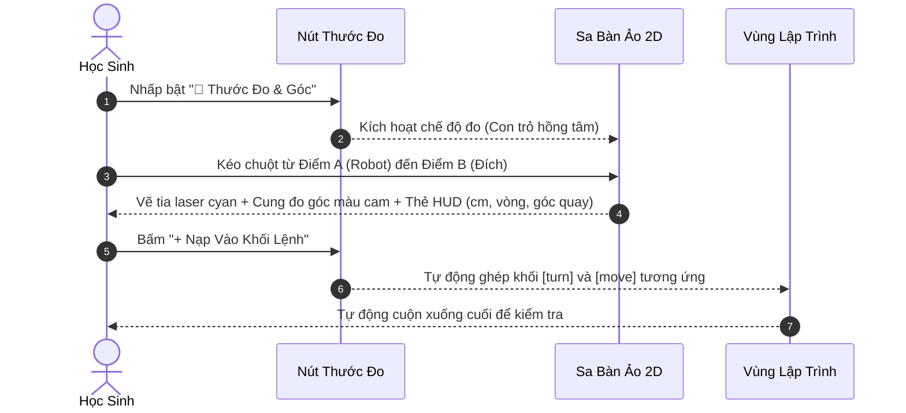

# SỔ TAY HƯỚNG DẪN SỬ DỤNG
## NỀN TẢNG THỰC HÀNH & MÔ PHỎNG ROBOT LEGO® EDUCATION SPIKE™ PRIME
> **Tác giả:** Thầy Hoàng Ngọc Cảnh — Giáo viên trường THCS & THPT Đinh Thiện Lý  
> **Địa chỉ trải nghiệm trực tuyến:** [https://hncanhlsts.github.io/lego-spike-prime-studio/](https://hncanhlsts.github.io/lego-spike-prime-studio/)  
> **Phiên bản:** Studio 3.5.2 (Tương thích chuẩn LEGO® SPIKE™ Prime App 3.5.1 & Python 3)

---

## MỤC LỤC
1. [Giới Thiệu Chung](#1-giới-thiệu-chung)
2. [Tổng Quan Cấu Trúc Giao Diện](#2-tổng-quan-cấu-trúc-giao-diện)
3. [Quy Trình 5 Bước Lập Trình Cho Học Sinh](#3-quy-trình-5-bước-lập-trình-cho-học-sinh)
4. [Hướng Dẫn Tính Năng Thước Đo & Góc Tương Tác (Ruler & Protractor)](#4-hướng-dẫn-tính-năng-thước-đo--góc-tương-tác-ruler--protractor)
5. [Hướng Dẫn Bộ Chuyển Đổi Bố Cục Sa Bàn Mở Rộng](#5-hướng-dẫn-bộ-chuyển-đổi-bố-cục-sa-bàn-mở-rộng)
6. [Chế Độ Gỡ Lỗi Từng Bước (Step-by-Step Debugger) & Tốc Độ Mô Phỏng](#6-chế-độ-gỡ-lỗi-từng-bước-step-by-step-debugger--tốc-độ-mô-phỏng)
7. [Hướng Dẫn Tự Thiết Kế Sa Bàn (Arena Editor)](#7-hướng-dẫn-tự-thiết-kế-sa-bàn-arena-editor)
8. [Không Gian Mô Phỏng 3D Tương Tác Vật Lý](#8-không-gian-mô-phỏng-3d-tương-tác-vật-lý)
9. [Bộ Não Hub, Cảm Biến & Chuyển Đổi Python Code](#9-bộ-não-hub-cảm-biến--chuyển-đổi-python-code)
10. [Hướng Dẫn Dành Cho Giáo Viên & Quản Lý Nhiệm Vụ (Mission Studio)](#10-hướng-dẫn-dành-cho-giáo-viên--quản-lý-nhiệm-vụ-mission-studio)

---

## 1. Giới Thiệu Chung

**LEGO® SPIKE™ Prime Studio** là nền tảng học tập trực tuyến tích hợp mô phỏng robot 2D/3D và môi trường lập trình kéo thả khối lệnh (Word Blocks) tương thích 100% với ứng dụng chính hãng LEGO Education SPIKE App. 

Nền tảng hỗ trợ:
* Học sinh luyện tập các thuật toán điều khiển robot cơ bản (đi thẳng, quay góc, nhận diện dải màu, né vật cản).
* Luyện thi các giải đấu robot danh tiếng như **FLL (FIRST® LEGO® League)**, **WRO (World Robot Olympiad)**, **RoboCup Rescue Line**.
* Tự động chấm điểm tiêu chí hoàn thành nhiệm vụ, hỗ trợ đo đạc khoảng cách và góc rẽ thực tế trên sa bàn.
* Kết nối trực tiếp với robot SPIKE Prime thật qua Bluetooth Web BLE.

---

## 2. Tổng Quan Cấu Trúc Giao Diện

Giao diện được phân chia khoa học thành **4 khu vực làm việc chính**:



### Chi tiết các khu vực:
* **Thanh Dự Án Trên Cùng:** 
  * Nút `Home`: Về bài học số 1.
  * Hộp chọn bài học: Phân theo 4 nhóm lộ trình (Nền tảng $\to$ Ứng dụng $\to$ Luyện thi FLL/WRO $\to$ Sáng tạo).
  * Bộ nút điều khiển chạy: `▶ Bắt đầu`, `⏹ Dừng lại`, `🐾 Từng bước` (Bước tiếp), tốc độ `0.5x | 1x | 2x`.
  * Hỗ trợ học tập: `Code khởi đầu`, `Gợi ý (1/3)`, `Xem Lời Giải Mẫu` (khóa bằng mã PIN đối với học sinh).
  * Thanh hiển thị Đề bài & Tiêu chí hoàn thành (tự động kiểm tra đạt/chưa đạt).
* **Cột 1 & 2 (Danh mục & Ngăn kéo khối):** Phân màu chuẩn theo SPIKE App (Motors xanh dương, Movement hồng, Light tím, Sound hồng nhạt, Events vàng, Control cam, Sensors xanh ngọc, Operators lục, Variables cam đậm, My Blocks đỏ).
* **Cột 3 (Vùng lập trình kéo thả):**
  * Nút tròn vàng `Connect` kết nối Bluetooth Web BLE với Robot thật.
  * Bảng giám sát nhanh giá trị 6 cổng A-F.
  * Vùng canvas chấm bi xám hỗ trợ cuộn 2 chiều với thanh cuộn nổi bật 11px (`.code-canvas-scrollbar`).
  * Nút cuộn nhanh thông minh: `⬆ Đầu trang` và `⬇ Cuối trang` (xuất hiện khi chương trình dài từ 6 khối trở lên).
* **Cột 4 (Khung kỹ thuật màu đỏ bên phải):**
  * Tab 1: **Sa Bàn Ảo (2D & 3D)** kèm công cụ Thước đo và Thiết kế sa bàn.
  * Tab 2: **Hub & Cảm Biến** (Ma trận đèn LED 5x5, Gyro, Động cơ).
  * Tab 3: **Python Code** (Tự động biên dịch từ khối lệnh sang mã Python 3 chuẩn kèm số thứ tự dòng).
  * Tab 4: **Cơ Cấu & Lắp Ráp** (5 mô hình mẫu SPIKE Prime).

---

## 3. Quy Trình 5 Bước Lập Trình Cho Học Sinh



1. **Bước 1 — Đọc đề bài:** Quan sát thanh màu vàng/xám trên cùng để nắm rõ mục tiêu nhiệm vụ và danh sách các tiêu chí bắt buộc.
2. **Bước 2 — Đo đạc trước khi code:** Bấm nút **`📐 Thước Đo & Góc`** trên sa bàn, kéo chuột từ tâm Robot đến đích để biết chính xác cần di chuyển bao nhiêu **cm**, bao nhiêu **vòng bánh xe (rotations)** và **rẽ góc bao nhiêu độ**.
3. **Bước 3 — Lập trình kéo thả:** Kéo các khối lệnh từ cột 2 thả vào dưới khối `when program starts`. Nhấp vào các ô số tròn để điều chỉnh tham số. Có thể bấm `+ Nạp Vào Khối Lệnh` ngay trên Thước đo để hệ thống tự động sinh khối lệnh!
4. **Bước 4 — Chạy thử nghiệm:**
   * Nhấn **`▶ Bắt đầu`** để robot tự hành trên sa bàn ảo.
   * Nếu muốn quan sát chi tiết từng câu lệnh, nhấn **`🐾 Từng bước`** rồi bấm **`Bước tiếp ▶`**.
5. **Bước 5 — Đánh giá & Chuyển bài:** Khi robot hoàn thành lộ trình, bảng thông báo kết quả (Grading Result) tự động hiện ra. Nếu Đạt, bấm `Bài Tiếp Theo →` để chinh phục cấp độ mới.

---

## 4. Hướng Dẫn Tính Năng Thước Đo & Góc Tương Tác (Ruler & Protractor)

Tính năng độc quyền giúp học sinh rèn luyện tư duy tính toán cơ học trước khi lập trình.



### Các thông số hiển thị trên thẻ HUD của thước:
* 📏 **Khoảng cách:** Đơn vị **cm** và **pixel** thực tế ($1\text{ cm} = 1.1\text{ px}$).
* 🔄 **Vòng quay bánh xe (rotations):** Tính chuẩn xác theo bánh xe LEGO SPIKE Prime đường kính $5.6\text{ cm}$ (Chu vi $1\text{ vòng} \approx 17.59\text{ cm}$).
* 🧭 **Góc quay robot ($\Delta\theta$):** Tính toán độ lệch giữa hướng nhìn hiện tại của robot và điểm đích:
  * `Rẽ phải +X°`: Góc quay thuận chiều kim đồng hồ.
  * `Rẽ trái -X°`: Góc quay ngược chiều kim đồng hồ.
  * `Đi thẳng (0°)`: Mục tiêu nằm thẳng trục mũi robot.
* **Các nút thao tác nhanh trên thước:**
  * `Gắn Robot`: Tự động đặt gốc tọa độ đo ngay tại tâm Robot.
  * `+ Nạp Vào Khối Lệnh`: Ghép ngay khối `turn_in_place` và `move_straight_distance` vào chương trình.
  * `✕ Xóa Thước`: Xóa đường đo đạc để đo tuyến đường khác.

---

## 5. Hướng Dẫn Bộ Chuyển Đổi Bố Cục Sa Bàn Mở Rộng

Trên thanh Tab sa bàn (góc trên bên phải), hệ thống cung cấp 3 chế độ không gian hiển thị:

| Chế độ | Tỉ lệ diện tích | Đặc điểm & Ứng dụng |
| :--- | :---: | :--- |
| **`⚖️ Cân Bằng`** | **52%** Sa bàn / 48% Code | Tỉ lệ chuẩn mặc định, cân đối giữa vùng ghép khối lệnh và sa bàn quan sát. |
| **`⛶ Mở Rộng`** | **68%** Sa bàn / 32% Code | Kéo dài chiều ngang sa bàn, sa bàn tự động phóng to theo tỉ lệ $520 : 265$. Thích hợp khi lập trình các lộ trình dài, đường cong zíc-zắc phức tạp. |
| **`🖥 Toàn Cảnh`** | **82%** Sa bàn / 18% Code | Khung sa bàn cực đại. Thích hợp cho các bài thi đua Sa bàn FLL Challenge, WRO Smart City, Đường đua F1. |

> [!TIP]
> Cho dù chọn chế độ Mở Rộng hay Toàn Cảnh, vùng lập trình bên trái vẫn được trang bị đầy đủ thanh cuộn 11px và nút cuộn nhanh nên học sinh luôn quan sát và chỉnh sửa mã lệnh dễ dàng.

---

## 6. Chế Độ Gỡ Lỗi Từng Bước (Step-by-Step Debugger) & Tốc Độ Mô Phỏng

Khi robot chạy sai hướng hoặc không đọc được màu, chế độ Gỡ lỗi từng bước giúp học sinh xác định nguyên nhân:

1. **Bật chế độ từng bước:** Nhấn nút **`🐾 Từng bước`** trên thanh trên cùng.
2. **Thực thi từng câu lệnh:** Nhấn nút **`Bước tiếp ▶`** mỗi lần muốn robot thực thi đúng 1 khối lệnh.
3. **Quan sát trực quan:**
   * Khối lệnh đang chạy sẽ phát sáng viền vàng nhấp nháy trên canvas.
   * Vệt đường đi (trail) màu hồng neon của robot vẽ rõ ràng trên sa bàn.
   * Mũi cảm biến màu (Port D) tự động đổi màu theo màu sàn thực tế dưới mũi xe.
   * Chùm sóng siêu âm (Port E) đổi sang màu đỏ cảnh báo nếu khoảng cách tới vật cản $\le 25\text{ cm}$.
4. **Bộ chọn tốc độ mô phỏng:** Chọn `0.5x` (chậm quan sát kỹ), `1x` (tốc độ thực tế), hoặc `2x` (chạy nhanh kiểm tra toàn bộ lộ trình).

---

## 7. Hướng Dẫn Tự Thiết Kế Sa Bàn (Arena Editor)

Nhấn nút **`🛠 Thiết Kế Sa Bàn`** trên thanh công cụ để kích hoạt bộ công cụ sáng tạo sa bàn:

```
[✏️ Vẽ Line Tự Do]  [📏 Đoạn Thẳng]  [🎯 Ô Đích]  [🛑 Vật Cản]  [🧱 Tường Ngang/Dọc]  [🎨 Dải Màu]  [📦 Kiện Hàng]  [📍 Đặt Robot]  [🧲 Hít Lưới]  [🧹 Tẩy]
```

* **Vẽ đường Line đen/màu:** Chọn công cụ `Vẽ Line` hoặc `Đoạn Thẳng`, giữ chuột trái và kéo rê trực tiếp trên mặt sàn để tạo đường line dò màu. Có thể tùy chỉnh độ dày ($8\text{px} \to 28\text{px}$) và màu sắc (Đen, Đỏ, Vàng, Xanh lá, Xanh dương).
* **Kéo thả di chuyển vật thể (`🖐 Di chuyển`):** Cho phép bấm chọn và kéo thả bất kỳ vật thể nào (vật cản, ô đích, vị trí xuất phát robot) sang vị trí mới.
* **Tải ảnh sa bàn tùy chỉnh (`🖼 Tải Ảnh Nền`):** Học sinh hoặc giáo viên có thể tải lên ảnh chụp sa bàn FLL/WRO thật từ máy tính làm nền sa bàn mô phỏng.
* **Xóa vật thể:** Dùng công cụ `Cục Tẩy` hoặc bấm `Xóa hết` để làm lại từ đầu.

---

## 8. Không Gian Mô Phỏng 3D Tương Tác Vật Lý

Bấm nút **`3D`** trên thanh công cụ để chuyển sang không gian 3D tương tác hoàn chỉnh:

* **Danh sách 6 sa bàn 3D cơ cấu:**
  1. *3D Sa bàn 1: Tay Gắp & Nâng Kiện Hàng (Grab & Lift)*
  2. *3D Sa bàn 2: Kéo - Thả & Phân Loại Kiện Hàng Màu (Sorting)*
  3. *3D Sa bàn 3: Xe Nâng Forklift & Xếp Giá Kệ Kho 2 Tầng (Forklift)*
  4. *3D Sa bàn 4: Cần Cẩu Tháp Xoay & Tời Nâng Vượt Tường (Crane)*
  5. *3D Sa bàn 5: Xe Ủi Bulldozer — Đẩy & Gom Khối Năng Lượng (Push)*
  6. *3D Sa bàn 6: Nhiệm Vụ FLL 3D — Hạ Cầu Rút & Vượt Dốc (Bridge)*
* **Thao tác chuột trong 3D:**
  * Giữ chuột trái & kéo: Xoay góc nhìn camera (Orbit).
  * Lăn chuột giữa: Phóng to / Thu nhỏ (Zoom).
  * Bấm nút gạt chế độ: Có thể dùng chuột nhặt và kéo thả trực tiếp kiện hàng trong không gian 3 chiều.

---

## 9. Bộ Não Hub, Cảm Biến & Chuyển Đổi Python Code

### Tab 2: Hub & Cảm Biến
* **Ma trận đèn LED 5x5:** Nhấp chuột trực tiếp vào từng ô vuông để bật/tắt đèn vàng. Khối lệnh `light_matrix_image` trong chương trình sẽ hiển thị đồng bộ lên ma trận này.
* **Giám sát cảm biến thời gian thực:**
  * Động cơ A & B (Bánh xe), Động cơ C (Cơ cấu tay gắp/nâng): Đo góc xoay $0^\circ \to 360^\circ$.
  * Cảm biến màu D: Tỉ lệ phản xạ ánh sáng ($0 \to 100\%$) và tên màu đọc được.
  * Cảm biến khoảng cách siêu âm E: Khoảng cách từ $4\text{ cm} \to 200\text{ cm}$.
  * Cảm biến lực F: Lực nhấn từ $0\text{ N} \to 10\text{ N}$.
  * Con quay hồi chuyển (Gyro Yaw): Góc xoay thân xe thời gian thực.

### Tab 3: Python Code
* Mã Python 3 tương thích chính hãng thư viện `spike` (`PrimeHub`, `MotorPair`, `ColorSensor`, `DistanceSensor`...).
* Tự động sinh mã nguồn song song khi học sinh ghép khối lệnh Word Blocks.
* Tích hợp **Cột số dòng**, thanh cuộn mượt và nút **`Copy Python`** để học sinh có thể copy nạp trực tiếp vào phần mềm SPIKE App chính hãng chạy trên robot thật!

---

## 10. Hướng Dẫn Dành Cho Giáo Viên & Quản Lý Nhiệm Vụ (Mission Studio)

### 1. Mã PIN Giáo Viên
* Để bảo vệ tính tự lập và thử thách cho học sinh, chức năng **`Xem Lời Giải Mẫu`** mặc định bị khóa.
* Giáo viên bấm vào nút `Xem Lời Giải Mẫu`, nhập mã PIN mặc định: **`1234`** để kích hoạt **Chế độ Giáo viên**.
* Sau khi nhập đúng mã PIN, giáo viên có thể mở xem sơ đồ khối chuẩn của bài học và bấm `Nạp Lời Giải Mẫu Vào Vùng Lập Trình` để minh họa cho cả lớp.

### 2. Quản Lý Nhiệm Vụ (Mission Studio)
Bấm nút **`⚙️ Quản Lý Nhiệm Vụ`** trên thanh trên cùng để mở bảng quản trị:
* **Tạo nhiệm vụ mới (`+ Thêm Nhiệm Vụ Mới`):** Đặt tên bài học, phân loại độ khó (Nền tảng, Ứng dụng, Luyện thi, Tự do), viết nội dung đề bài và gợi ý.
* **Thiết lập tiêu chí chấm điểm tự động:** Cài đặt vị trí tọa độ vùng đích ($X, Y$), thời gian tối đa, hoặc số lượng kiện hàng cần thu gom.
* **Lưu cấu hình sa bàn hiện tại:** Nạp toàn bộ đường line, tường chắn, kiện hàng vừa thiết kế vào dữ liệu bài học.
* **Xuất / Nhập file JSON:**
  * `Xuất JSON`: Tải toàn bộ ngân hàng câu hỏi & sa bàn về máy tính thành file `.json` để lưu trữ hoặc chia sẻ cho các trường/lớp khác.
  * `Nhập JSON`: Nạp giáo trình hoặc bài kiểm tra từ đồng nghiệp.
  * `Khôi phục mặc định`: Trả về 8 bài học chuẩn ban đầu của Thầy Hoàng Ngọc Cảnh.

---

> [!NOTE]
> Mọi ý kiến đóng góp, phản hồi kỹ thuật hoặc đề xuất tính năng mới xin vui lòng liên hệ **Thầy Hoàng Ngọc Cảnh** — Trường THCS & THPT Đinh Thiện Lý. Chúc quý Thầy Cô và các em học sinh có những tiết học Robotics sáng tạo và bổ ích!
